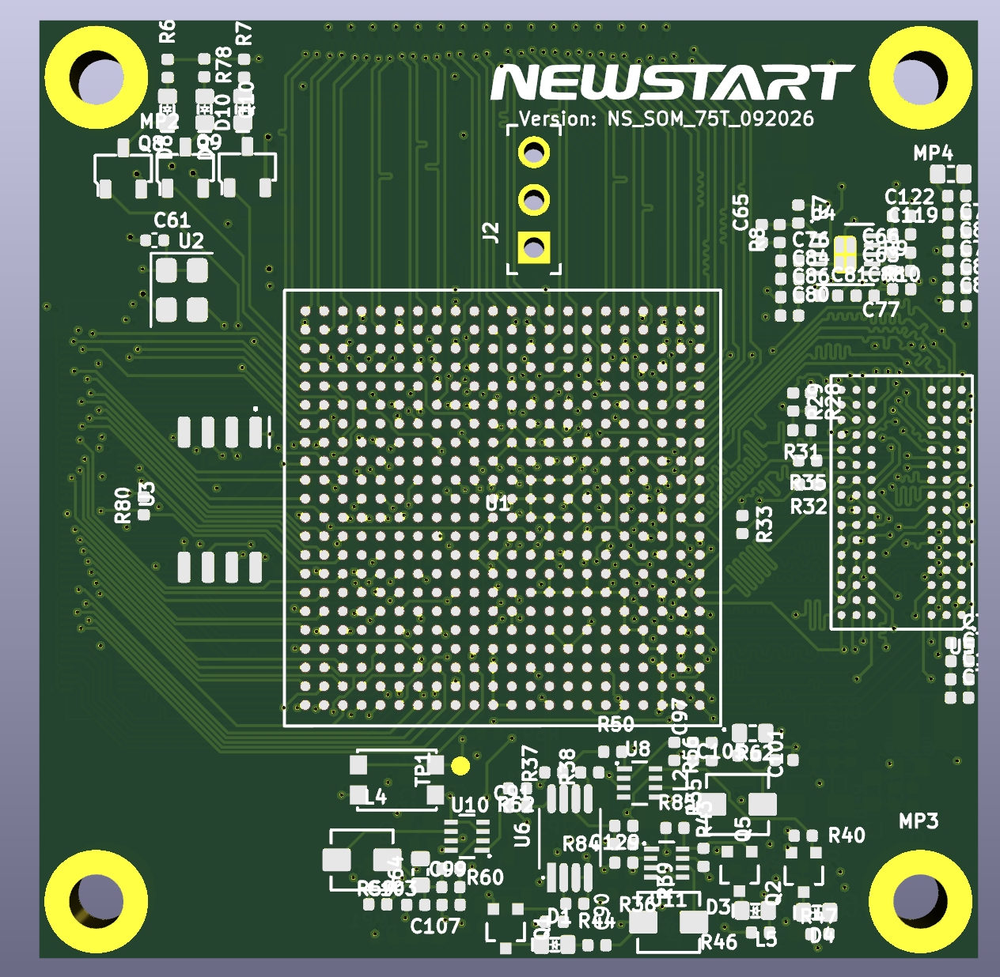
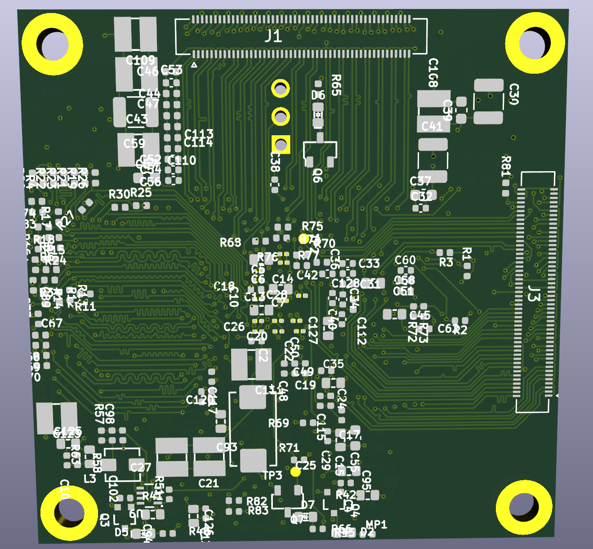
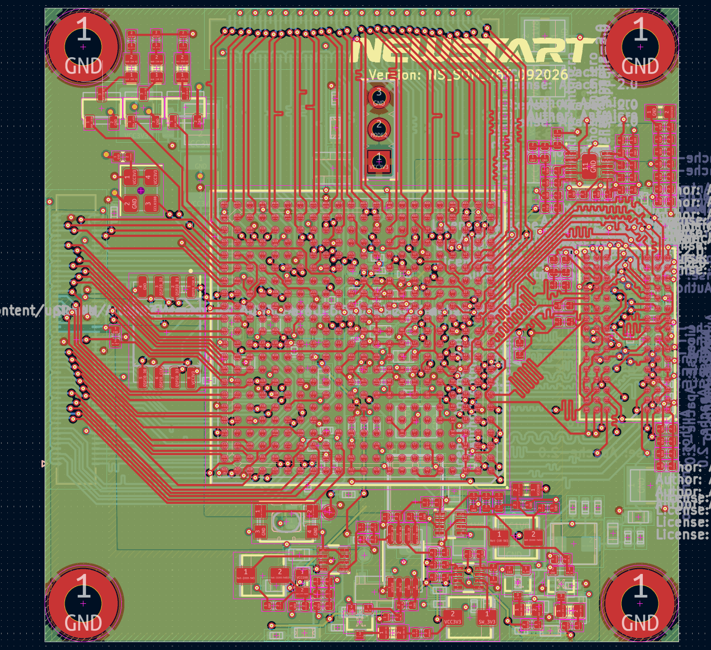
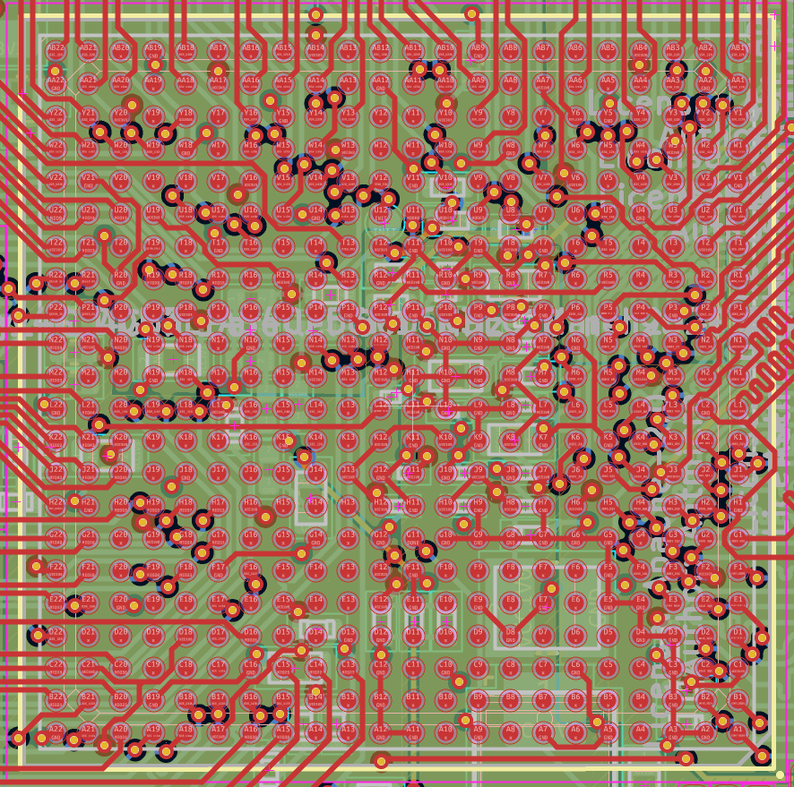
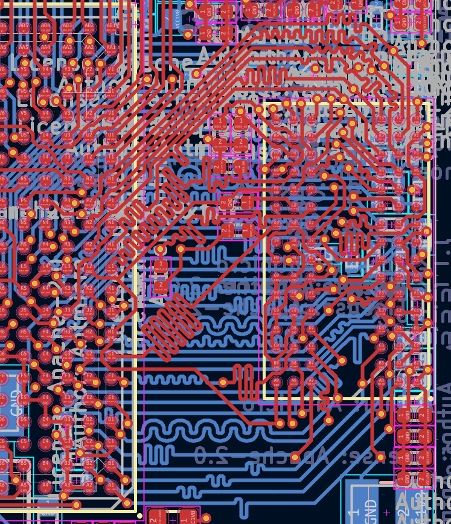

# Artix-7 FPGA Board – 4-Layer PCB Design

## 1. Project Overview

This project involves the PCB design of an FPGA-based hardware platform using the **Xilinx Artix-7 XC7A75T-FGG484** device.

The design focuses on FPGA component integration, BGA fanout, multilayer PCB layout, and high-speed signal routing.

## 2. Hardware Platform

| Item | Description |
|---|---|
| FPGA | Xilinx Artix-7 XC7A75T |
| FPGA Package | FGG484 |
| PCB Layer Count | 4 Layers |
| Memory Interface | DDR3L |
| PCB Design Tool | KiCad |

## 3. PCB Design

The PCB design covers the following areas:

- FPGA component placement and routing.
- BGA fanout and escape routing.
- DDR3L signal routing.
- Power distribution and component placement.
- Multilayer PCB layout organization.

## 4. High-Speed Design Considerations

Key design considerations include:

- BGA fanout and routing constraints.
- DDR3L signal routing.
- Signal integrity considerations.
- PCB layer utilization and routing strategy.
- Power and ground distribution.

## 5. Design Gallery

### PCB 3D View – Top

### PCB 3D View – Bottom

### PCB 2D Layout

### FPGA BGA Fanout

### DDR3L Routing

## 6. Tools & Technologies

- KiCad
- Xilinx Artix-7 FPGA
- DDR3L Memory Interface
- Multilayer PCB Design
- BGA Fanout and High-Speed Routing

## 7. Project Notes

This repository is intended to document the PCB design process and demonstrate practical experience in FPGA hardware design and high-speed PCB layout.
